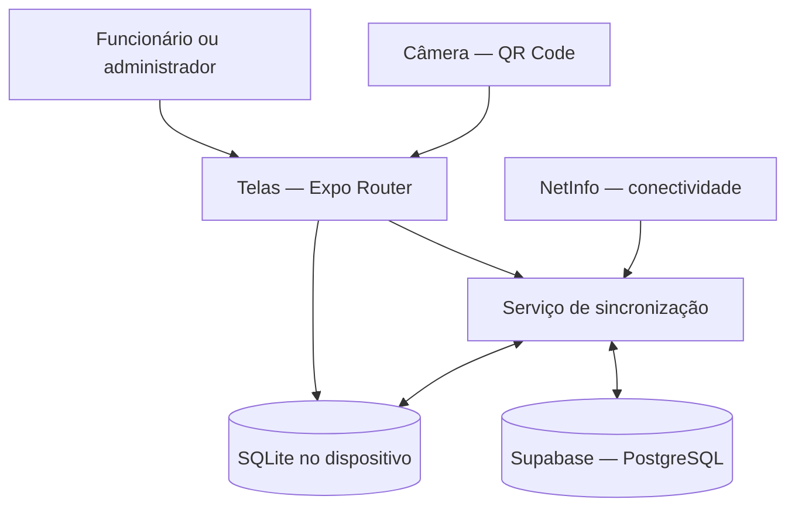

<p align="center">
  
</p>

<h1 align="center">AccessID</h1>
<p align="center"><strong>Controle de presença por QR Code e PIN, com registros locais e sincronização.</strong></p>
<p align="center">Android · Expo SDK 58 · React Native · SQLite · Supabase</p>

---

O **AccessID** é um aplicativo acadêmico para registrar entradas e saídas de funcionários. Ele reúne identificação por crachá QR Code ou matrícula e PIN, gerenciamento de funcionários e consulta do histórico em um dispositivo móvel.

A proposta é reduzir a dependência de anotações manuais e permitir que o registro de presença continue quando a conexão cair. Os dados são gravados primeiro no SQLite do aparelho; a comunicação com o Supabase ocorre quando há conexão e o serviço está disponível.

> **Entrega acadêmica:** código-fonte, instruções de execução e aplicativo Android. A implementação está disponível para avaliação; as limitações e os pontos que exigem validação em aparelho estão descritos abaixo.

## Navegação

- [Funcionalidades](#funcionalidades)
- [Como testar](#como-testar)
- [Primeiro acesso e fluxo de uso](#primeiro-acesso-e-fluxo-de-uso)
- [Arquitetura e dados](#arquitetura-e-dados)
- [Tecnologias](#tecnologias)
- [Estrutura do projeto](#estrutura-do-projeto)
- [Testes e qualidade](#testes-e-qualidade)
- [Gerar APK Android](#gerar-apk-android)
- [Status e limitações](#status-e-limitações)
- [Integrantes da equipe](#integrantes-da-equipe)
- [Licença](#licença)

## Funcionalidades

| Recurso | Comportamento implementado |
| --- | --- |
| Identificação por QR Code | Lê `ACCESSID:<matrícula>` pela câmera e procura um funcionário ativo no banco local. |
| Identificação por PIN | Valida matrícula e PIN do funcionário como alternativa ao crachá. |
| Confirmação de presença | Exibe a identificação antes de gravar a entrada ou saída; permite cancelar. |
| Operação offline | Mantém cadastros e registros no SQLite do dispositivo. |
| Administração | Cria um PIN local no primeiro acesso e protege as telas administrativas por sessão. |
| Funcionários | Cadastra nome, matrícula, setor, cargo, horários de turno e PIN; permite ativar, desativar e redefinir o PIN do funcionário. |
| Geração de crachá | Exibe QR Code de funcionários ativos, sem colocar o PIN no código. |
| Painel | Apresenta total de funcionários, presentes e fora da empresa conforme a regra diária. |
| Histórico | Exibe data, horário, método, entrada/saída e situação da sincronização. |
| Sincronização | Concilia funcionários por matrícula e registros por UUID; oferece acionamento automático e manual. |

## Como testar

### Opção 1 — Aplicativo Android (APK)

O APK executa o AccessID independentemente do Expo Go e do servidor de desenvolvimento.

**Versão identificada:** `1.0.1`, Android `versionCode 2`.

**[Baixar APK Android — versão 1.0.1](https://expo.dev/artifacts/eas/QE6JwTiPWUM9IcPWcfYkxWCfZDacUOxE0m1NZq4EpeY.apk)** · aproximadamente 137 MB

Link de download verificado sem autenticação em 16/11/2026. O build EAS informa expiração em **25/11/2026**; para manter o acesso durante a avaliação, a equipe deve anexar o APK a uma GitHub Release e substituir este link antes dessa data.

SHA-256 do APK disponível:

```text
CDD640F6E2986EE1F1673A0ED0921D49E06BB7646FADB480FD2AA9F251FB4AF5
```

O APK disponível corresponde às funcionalidades e aos recursos visuais desta entrega.

Após obter o APK disponibilizado pela equipe:

1. Abra o arquivo no Android e autorize a instalação pela origem utilizada, se o sistema solicitar.
2. Inicie o AccessID e siga o [primeiro acesso](#primeiro-acesso-e-fluxo-de-uso).
3. Autorize a câmera ao usar a leitura de crachá.

O APK contém a configuração de serviço definida no build. Para uma avaliação isolada, use a variante QA descrita em [Testes](docs/TESTING.md). Não utilize dados pessoais reais nas demonstrações. Uma atualização com a mesma assinatura preserva o armazenamento; desinstalar ou limpar os dados pode eliminar registros ainda não sincronizados.

### Opção 2 — Executar pelo Expo Go

**Pré-requisitos**

- Node.js **24 LTS**, npm e Git.
- Android com Expo Go compatível com **Expo SDK 58**.
- Computador e aparelho com acesso ao mesmo servidor de desenvolvimento.
- Configuração de um Supabase de homologação para validar a sincronização.

Baixe ou clone este repositório, entre na pasta `AccessID` e instale as versões do lockfile:

```bash
npm ci
```

Copie `.env.example` para `.env` somente se o arquivo local ainda não existir. Preencha com a configuração do seu ambiente de homologação:

```dotenv
EXPO_PUBLIC_SUPABASE_URL=https://SEU-PROJETO.supabase.co
EXPO_PUBLIC_SUPABASE_ANON_KEY=SUA_CHAVE_ANON
```

Essas variáveis são incorporadas ao cliente. Nunca utilize uma chave `service_role` ou outra credencial administrativa. A proteção remota depende das políticas do banco, não do sigilo da chave pública do aplicativo.

Inicie o servidor:

```bash
npm start
```

Abra o Expo Go e leia o QR do terminal. Mantenha o servidor ativo durante o uso. Se necessário, reinicie limpando o cache:

```bash
npm start -- --clear
```

Se o celular não conectar, confira a rede, o firewall e a interface selecionada pelo Metro; uma VPN pode alterar o endereço anunciado. A versão do Expo Go precisa aceitar o SDK do projeto. O armazenamento dessa execução é separado do APK independente.

**Configuração remota pendente de reprodução completa:** o repositório não contém migrations PostgreSQL nem políticas RLS exportadas. Consulte o [contrato esperado do Supabase](#contrato-esperado-do-supabase) antes de tentar sincronizar. A instalação das dependências, sozinha, não provisiona o backend.

## Primeiro acesso e fluxo de uso

1. Abra **Área administrativa**. Em uma instalação nova, crie e confirme um PIN de 4 a 6 dígitos. Não existe senha administrativa padrão.
2. Em **Gerenciar funcionários**, cadastre um funcionário sintético com matrícula única e PIN.
3. Para utilizar o crachá, abra a aba **Gerar QR Code**, selecione o funcionário ativo e mostre o código em outra tela.
4. Volte à tela inicial e escolha **Escanear crachá**, ou identifique-se pela matrícula e PIN.
5. Confira o funcionário e confirme a operação. A primeira marcação do dia é entrada; as seguintes alternam entrada e saída.
6. Consulte o histórico e o painel administrativo. Para verificar o envio, utilize **Sincronizar dados agora** com o ambiente de homologação configurado.

O crachá precisa corresponder a um cadastro ativo no aparelho leitor. O [crachá sintético QA01](docs/cracha-qa01.png) auxilia o teste óptico, mas não cria o funcionário automaticamente. Preserve a matrícula exata, inclusive zeros à esquerda.

O PIN administrativo pertence à instalação local e não é sincronizado com o Supabase. A versão atual não possui fluxo de recuperação de PIN administrativo.

## Arquitetura e dados



As rotas ficam em `src/app`. Componentes reutilizáveis ficam fora das rotas; a persistência está concentrada em `src/database/database.ts`. `src/services/sync.ts` faz a conciliação remota. A sessão administrativa é mantida em memória.

### Persistência local

| Tabela | Responsabilidade |
| --- | --- |
| `funcionarios` | Cadastro, matrícula única, turno, hash do PIN, status ativo e situação de sincronização. |
| `registros_acesso` | UUID, vínculo ao funcionário local, entrada/saída, horário, método e situação de sincronização. |
| `configuracoes` | Configurações da instalação, incluindo o hash do PIN administrativo. |

O SQLite é inicializado automaticamente. O código contém compatibilidade com dados legados, incluindo migração de PIN e preenchimento de UUIDs.

### Sincronização e funcionamento offline

- A inicialização e o retorno da conectividade acionam a sincronização; o painel também permite acioná-la manualmente.
- Chamadas simultâneas compartilham a execução em andamento dentro do processo.
- Cadastros são conciliados por matrícula e marcações por UUID.
- O serviço consulta dados remotos em páginas e compara os dados locais; não se limita a enviar apenas registros pendentes.
- Marcações ausentes ou divergentes na releitura remota permanecem pendentes para nova tentativa.
- A operação offline depende de o funcionário já estar cadastrado ou ter sido sincronizado para o dispositivo.

### Contrato esperado do Supabase

O cliente acessa as tabelas abaixo. Esta descrição foi extraída de `src/services/sync.ts`; **não substitui um esquema SQL validado**.

| Tabela | Campos acessados pelo cliente |
| --- | --- |
| `funcionarios` | `id`, `nome`, `matricula`, `setor`, `cargo`, `turno_inicio`, `turno_fim`, `pin_hash`, `ativo`, `created_at` |
| `registros_acesso` | `uuid`, `local_id`, `funcionario_matricula`, `tipo`, `data_hora`, `metodo`, `created_at` |

O upsert exige unicidade de `funcionarios.matricula` e `registros_acesso.uuid`. O vínculo remoto usa a matrícula; `local_id` é consultado para compatibilidade legada. A existência de constraints adicionais, defaults e políticas RLS deve ser confirmada no ambiente remoto.

Para reproduzir a sincronização, a equipe precisa fornecer migrations e políticas revisadas para uma instância de homologação. Não desative RLS nem conceda acesso amplo a dados pessoais para contornar erros. O PIN administrativo local não autentica uma sessão Supabase Auth.

## Tecnologias

Versões declaradas no `package.json`; o `package-lock.json` fixa a resolução utilizada pelo npm.

| Camada | Tecnologia |
| --- | --- |
| Aplicativo | Expo `~58.0.23`, React Native `0.88.1`, React `19.3.0` |
| Linguagem | TypeScript `~6.0.3` |
| Navegação | Expo Router `~58.0.30` |
| Persistência local | Expo SQLite `~58.0.15` |
| Backend | Supabase JS `^2.117.2` e PostgreSQL remoto |
| Leitura e geração de QR | Expo Camera `~58.0.14`, react-native-qrcode-svg `^6.3.54`, react-native-svg `15.16.0` |
| Conectividade e hashes | NetInfo `12.0.1`, Expo Crypto `~58.0.7` |
| Qualidade | Jest 30, React Native Testing Library 14, ESLint 9 e TypeScript |
| Distribuição | EAS Build, perfil Android `preview` |

A versão de distribuição é `1.0.1` em `app.json`. O campo `version` do pacote npm permanece `1.0.0`; ele não é a versão exibida pelo APK.

## Estrutura do projeto

```text
AccessID/
├── src/
│   ├── app/                 # Rotas, telas e inicialização
│   ├── components/          # Leitor, crachás e identidade visual
│   ├── database/            # SQLite, consultas e migrações locais
│   └── services/            # Administração, QR e sincronização
├── assets/images/           # Ícones e logo utilizados pelo aplicativo
├── tests/                   # Suítes e adaptadores isolados
├── docs/                    # Procedimentos de testes e crachá sintético
├── scripts/                 # Verificação do bundle Android
├── .github/workflows/       # Automação de qualidade
├── .maestro/                # Roteiro E2E Android
├── app.json                 # Identidade, permissões e plugins Expo
├── app.config.js            # Configuração isolada da variante QA
├── eas.json                 # Perfis de build
├── .env.example             # Modelo de variáveis, sem credenciais reais
├── package.json             # Dependências e comandos
└── package-lock.json        # Versões resolvidas para npm ci
```

## Testes e qualidade

```bash
npm run quality
```

| Comando | Finalidade |
| --- | --- |
| `npm run lint` | ESLint sem novos avisos. |
| `npm run typecheck` | Verificação estática TypeScript. |
| `npm test` | Testes automatizados de banco, sincronização, registro e crachás. |
| `npm run quality:fast` | Lint, tipos e testes. |
| `npm run check:android` | Exportação Android de produção em diretório temporário. |
| `npm run quality` | Todas as verificações acima. |
| `npm run test:e2e` | Roteiro Maestro, com APK QA, ADB e dispositivo preparados. |

Os testes usam SQLite em memória, dados sintéticos, rede simulada e bloqueio de chamadas externas. A exportação utiliza configuração fictícia e não lê o `.env` local.

O workflow [Qualidade](.github/workflows/quality.yml) está configurado para pushes e pull requests. Sua existência não comprova uma execução remota aprovada. O bundle verifica o empacotamento JavaScript; não substitui instalação, câmera e persistência nativas em aparelho.

Veja [procedimentos e limites dos testes](docs/TESTING.md), incluindo testes ópticos do QR e validação remota. Há quatro supressões legadas controladas de `react-hooks/set-state-in-effect`; não devem ser ampliadas para esconder regressões.

## Gerar APK Android

O perfil `preview` de `eas.json` está configurado para produzir APK:

```bash
npx eas-cli@latest login
npx eas-cli@latest build --platform android --profile preview
```

É necessário acesso ao projeto Expo vinculado, às credenciais de assinatura e às variáveis de ambiente do build. Para criar uma cópia independente do projeto, configure seu próprio vínculo Expo; para atualizar a instalação existente, preserve o pacote e a assinatura.

Confira as variáveis do ambiente EAS utilizado pelo perfil antes de iniciar. Um `.env` local não garante a configuração do build remoto. Aguarde a conclusão e instale o artefato para validar o funcionamento nativo.

O perfil `e2e` gera uma variante separada (`com.pablovitor.accessid.qa`) com endpoint fictício para testes isolados. O perfil `production` não é o perfil escolhido aqui para distribuição direta por APK.

Referências oficiais: [Expo SDK 58](https://docs.expo.dev/versions/v58.0.0/) e [geração de APK pelo EAS](https://docs.expo.dev/build-reference/apk/).

## Status e limitações

- **Implementado:** cadastro, PIN, leitura e geração de QR, marcações offline, histórico, painel e conciliação com Supabase.
- **Validação adicional:** câmera real, instalação e atualização do APK, políticas remotas e sincronização em homologação precisam de verificações próprias; testes simulados não comprovam esses cenários.
- **Segurança:** PINs usam SHA-256 simples. Não há recuperação administrativa, bloqueio por tentativas ou autenticação remota vinculada à sessão local. É necessário avaliar essas limitações antes de uso com dados reais.
- **Crachá:** o QR identifica uma matrícula e pode ser copiado. Não comprova identidade biométrica.
- **Conflitos:** a conciliação pode priorizar valores locais; alterações concorrentes entre aparelhos não possuem resolução robusta de conflitos.
- **Horários:** marcações dependem do relógio do dispositivo e da alternância por dia. Turnos que atravessam a meia-noite não têm tratamento específico.
- **Escala:** a sincronização percorre o conjunto de dados; grandes volumes exigem avaliação de desempenho.
- **Backend reproduzível:** migrations e políticas PostgreSQL ainda não estão versionadas.
- **Distribuição:** o download EAS é temporário; a publicação do APK em uma GitHub Release permanece pendente.

Reconhecimento facial, exportação de relatórios e recuperação de PIN administrativo não fazem parte das funcionalidades entregues.

## Integrantes da equipe

| Nome completo | Matrícula |
| --- | --- |
| João Vitor Santos Carvalho | 25391 |
| Gabriel Rodrigues Mota | 25446 |
| Pablo Vinicius Soares Vitor | 25235 |
| Patrick Soares Vitor | 25237 |
| João Pedro Beloti Freitas | 25489 |

## Licença

O repositório contém a [licença MIT](LICENSE), com o aviso de copyright original da Expo preservado. Nenhuma nova atribuição de autoria foi acrescentada.
